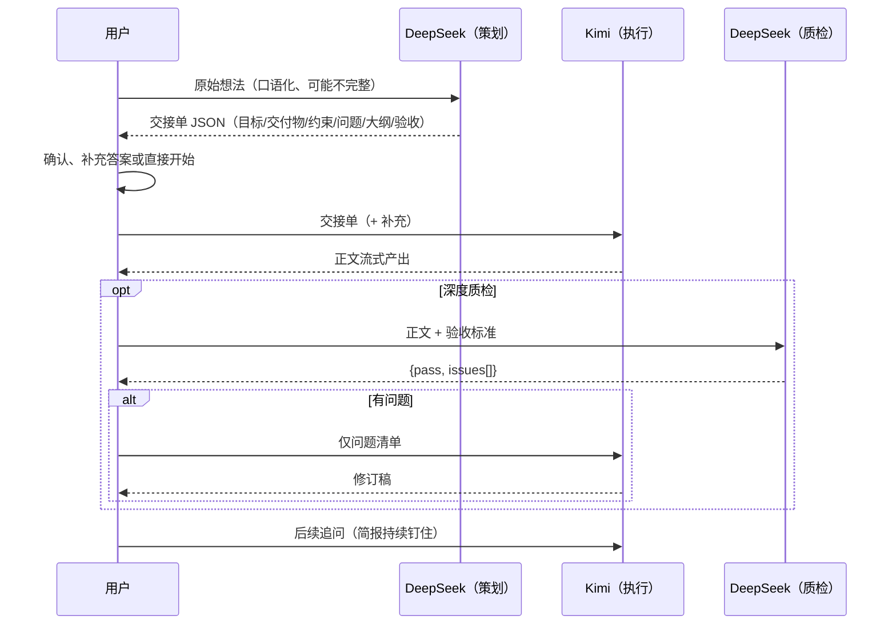

# FlowHub 多 AI 接力协同 · 设计方案与 Kimi 交接单

> 目标：把「DeepSeek 先完善想法 → 总结成交接单 → 交给 Kimi 高效执行/对话」落成一套可实现、可验证的协作协议。
> 本文既是对现有产品的完善，也是给 Kimi 的实施 brief。可直接整篇贴给 Kimi。

---

## 0. 一句话结论

现在不是“没有 AI 交互”，而是**交互只发生在一次隐藏的 prompt 拼接里**：用户看不见传了什么，也无法在中间介入；而且只有 Kimi key 时会退化成“Kimi 复核 Kimi”。
要补的不是并排窗口，而是把**「交接」变成产品的一等公民**：可见的交接单、可确认的检查点、可继续的协作链。

---

## 1. 现状核对（基于当前代码）

| 模式 | 行为 | 代码位置 |
|---|---|---|
| 单聊 | 当前模型独立流式回答 | `src/components/workspace/ChatInput.tsx:447-526` |
| 多模型对比 | 同一句话并发给 2 个模型，并排展示，**互不传递** | `ChatInput.tsx:361-445` |
| AI 协同 | A 先答 → A 的全文被塞进 B 的 prompt → B 纠错并给最终答案，只跑一轮 | `ChatInput.tsx:252-358` |

渲染层已有 `compare` / `collab` 两种消息形态：
- `src/components/workspace/MessageList.tsx:95-172`
- 类型定义见 `src/lib/types.ts:41-71`

### 为什么用户会觉得“交互为零”

1. **第二步的输入不可见**：B 收到的 prompt 是把 A 的全文拼进去，但界面只显示两条结果，没有“传递”这件事。
2. **谁先说取决于当前选中模型**：`first = currentModel`，不保证是 DeepSeek 先梳理、Kimi 后执行（`ChatInput.tsx:268-270`）。
3. **只有一个 key 时自我复核**：`second = pool.find(m => m !== first) ?? first`，solo 时就是同一个模型（`ChatInput.tsx:272-273`）。
4. **协作链在下一轮断掉**：`buildHistoryForModel` 对 collab 消息只取“该模型自己最近一步”，Kimi 看不到 DeepSeek 的初稿，DeepSeek 也看不到 Kimi 的终稿（`src/lib/ai-client.ts:218-224`）。
5. **没有用户介入点**：不能改简报、不能补信息、不能指定“只让 Kimi 继续”，也没有阶段状态与成本。

> 结论：现有实现是“一次性双人接龙”，不是“可运营的协作流程”。

---

## 2. 产品设计：接力协同（Relay Collaboration）

### 2.1 角色分工

| 角色 | 默认模型 | 职责 | 成本定位 |
|---|---|---|---|
| 策划 Planner | DeepSeek | 把口语化想法整理成结构化交接单；缺信息时最多问 3 个问题；**不写正文** | 便宜、快 |
| 执行 Executor | Kimi | 只拿交接单 + 用户补充，产出最终交付物；后续追问也由它承接 | 长文、对话强 |
| 质检 Reviewer（可选） | DeepSeek | 按验收标准检查执行结果，输出问题列表（JSON） | 便宜 |
| 修订 Reviser（可选） | Kimi | 只针对质检问题修订，最多 1 轮 | 可控成本 |

**设计原则**

1. **交接单是唯一契约**：执行方不读原始闲聊，只读简报，避免上下文污染与 token 浪费。
2. **人始终在环上**：策划完必须经过“确认/补充/直接执行”三选一（可设置默认自动）。
3. **每一步可见**：谁在说、说了多久、花了多少钱、给对方传了什么，都能展开看。
4. **失败可恢复**：任一步失败不丢前序产出，可单独重试该步。
5. **协作可延续**：接力完成后，简报钉在会话里，后续对话继续由执行方承接。

### 2.2 状态机

```
idle
  └─(用户发送)→ planning ──失败──→ error
                   │
                   ▼
             awaiting_confirm ──(用户编辑/补充/直接执行)──→ executing
                                                              │
                                          ┌───────────────────┤
                                          ▼                   ▼
                                      reviewing ──有问题──→ revising → done
                                          │                              ▲
                                          └────通过/跳过──────────────────┘
```

- `deepReview` 关闭时：`executing → done`。
- 任意阶段可 `cancelled`；已完成的步骤保留。

### 2.3 一次完整交互（时序）



---

## 3. 界面设计

### 3.1 模式切换

把现有 `单聊 / ⚡ 多模型对比 / 🤝 AI 协同` 调整为：

```
[单聊] [⚡ 对比] [🧭 接力]
```

- 「对比」保留：用于选型、评估，不改。
- 「接力」替代原「协同」：原协同可作为接力里的 `deepReview` 近似能力，不单独占一个模式。
- 接力模式下，输入框上方出现一行配置：`策划 DeepSeek ▾ · 执行 Kimi ▾ · 深度质检 ⚪`

### 3.2 协作时间线卡片

一条消息内纵向渲染，节点之间用箭头 + “传递内容”连接：

```
[D] DeepSeek · 策划            4.2s · 1.8k tok · ¥0.003   [展开输入]
      │  交接单（可编辑）
      ▼
[你] 确认 · 补充：预算 50 万，面向投资人
      │
      ▼
[K] Kimi · 执行               18.7s · 12.4k tok · ¥0.21    [流式]
      │
      ▼
[D] DeepSeek · 质检  ✓ 通过
```

要求：
- 每个节点用模型品牌色（Kimi `#9381FF`、DeepSeek `#2EA7FF`），禁止混色。
- 节点头部：模型名 · 阶段 · 耗时 · token · 估算成本。
- 节点可折叠；“展开输入”显示该步实际发送的 prompt（脱敏后）。
- 交接单单独渲染为卡片，字段化展示，可一键复制 Markdown。

### 3.3 交接单卡片

字段：

| 字段 | 说明 |
|---|---|
| 目标 goal | 这次到底要解决什么 |
| 交付物 deliverable | 最终产物形态（文档/表格/方案/代码…） |
| 受众 audience | 给谁看 |
| 约束 constraints | 篇幅、语气、预算、截止时间、禁用项 |
| 待确认问题 questions | 最多 3 个，缺信息才问 |
| 建议大纲 outline | 3–6 条 |
| 验收标准 acceptance | 3–5 条可勾选标准 |

操作：
- `编辑简报`：切成 textarea 直接改 Markdown/JSON。
- `重新策划`：丢弃当前简报重跑 Planner。
- `直接执行`：跳过确认。
- `换执行模型`：在已配 key 的真实模型中切换。

### 3.4 会话级接力状态

- 接力完成后，会话顶部出现徽章：`接力中 · 执行 Kimi · 查看简报`。
- 后续用户消息默认发给执行模型，并在 system 里前置固定简报（不重复发全文）。
- 点徽章可查看/替换/解除简报。

---

## 4. 数据模型

在 `src/lib/types.ts` 扩展（保留现有 `compare` / `collab` 兼容）：

```ts
export type CollabPhase =
  | "planning"
  | "awaiting_confirm"
  | "executing"
  | "reviewing"
  | "revising"
  | "done"
  | "error"
  | "cancelled";

export interface CollabBrief {
  goal: string;
  deliverable: string;
  audience?: string;
  constraints: string[];
  questions: string[];
  outline: string[];
  acceptance: string[];
  /** 原始 Markdown，编辑时以它为准 */
  raw: string;
}

export interface CollabStep {
  model: ModelId;
  /** 策划 / 执行 / 质检 / 修订 */
  stage: "策划" | "执行" | "质检" | "修订";
  content: string;
  /** 该步实际发给模型的 prompt（折叠展示） */
  input?: string;
  ms?: number;
  tokens?: number;
  costYuan?: number;
  error?: string;
}

export interface CollabRun {
  id: string;
  planner: ModelId;
  executor: ModelId;
  deepReview: boolean;
  phase: CollabPhase;
  brief?: CollabBrief;
  /** 用户在确认阶段补充的内容 */
  userNote?: string;
  steps: CollabStep[];
  createdAt: number;
}
```

`ChatMessage` 增加：

```ts
collabRun?: CollabRun;
```

> 兼容策略：旧的 `collab?: CollabStep[]` 保留渲染分支；新流程写 `collabRun`。

Store（`src/lib/store.ts`）新增：
- `patchCollab(sessionId, messageId, patch)`：复用 `patchMessage` 即可，不必新增 action。
- `sessionBrief: Record<string, { brief: CollabBrief; executor: ModelId }>` + `setSessionBrief / clearSessionBrief`，随 persist 持久化。
- 注意：`partialize` 里加入 `sessionBrief`。

---

## 5. 实现清单

### 5.1 新增 `src/lib/collab-ai.ts`

```ts
/** 策划：返回结构化交接单。优先 JSON，失败回退 Markdown。 */
export async function planBrief(input: {
  userText: string;
  apiKey: string;
  model: ModelId;
  signal?: AbortSignal;
}): Promise<{ ok: true; brief: CollabBrief } | { ok: false; error: string }>;

/** 执行：流式产出正文。 */
export async function runExecutor(input: {
  brief: string;
  userNote?: string;
  model: ModelId;
  apiKey: string;
  signal: AbortSignal;
  onToken: (delta: string) => void;
}): Promise<{ ok: true; content: string } | { ok: false; error: string; content: string }>;

/** 质检：返回问题列表。 */
export async function reviewOutput(input: {
  brief: string;
  output: string;
  apiKey: string;
  model: ModelId;
}): Promise<{ pass: boolean; issues: { where: string; problem: string; fix: string }[] }>;

/** 修订：仅针对 issues 重写。 */
export async function reviseOutput(input: {
  output: string;
  issues: { where: string; problem: string; fix: string }[];
  apiKey: string;
  model: ModelId;
  signal: AbortSignal;
  onToken: (delta: string) => void;
}): Promise<string>;
```

解析容错（Planner JSON）：
1. 直接 `JSON.parse`。
2. 剥 ```json 围栏后解析。
3. 正则取第一个 `{...}` 或 `[...]`。
4. 全失败：把整段文本塞进 `brief.raw`，字段留空，`toast("交接单已降级为纯文本")`，仍允许执行。

### 5.2 新增 `src/components/workspace/CollabTimeline.tsx`

Props：`sessionId`、`messageId`、`run: CollabRun`。
职责：
- 渲染阶段节点、箭头、耗时/成本。
- 交接单卡片 + 编辑态。
- 确认阶段的三个按钮。
- 执行/修订的流式文本（父组件通过本地 state 传入，或组件内订阅 store）。
- 失败步骤的“重试”。

### 5.3 修改 `ChatInput.tsx`

- `mode` 增加 `"relay"`，替换 `"collab"` 入口（旧值可保留但不出现在 UI）。
- 发送时若 `mode === "relay"`：
  1. 校验 planner / executor 的 key；缺 planner → 用 executor 兼任并 toast；缺 executor → 阻止并引导设置。
  2. push 用户消息。
  3. 本地 state `relayLive` 显示“策划中…”。
  4. `planBrief()` 成功后 `pushAiMessage` 写入 `collabRun.phase = "awaiting_confirm"`。
  5. 用户在卡片点“直接执行/开始执行”→ `patchMessage` 改 phase 为 `executing`，`runExecutor()` 流式；token 增量只更新本地 state，结束一次性写 store。
  6. `deepReview` 开启且 `brief.acceptance.length > 0` → `reviewOutput()`；有问题则 `reviseOutput()` 一次。
  7. 最终 `patchMessage` 写回完整 `steps`、`phase = done`、成本。
- 取消：`abortRef` 贯穿 Planner/Executor/Reviser；取消后 phase = `cancelled`，保留已得内容。
- 发送按钮 disabled 条件加上“接力运行中”。

### 5.4 修改 `MessageList.tsx`

- 识别 `m.collabRun`，优先走 `<CollabTimeline />`。
- 旧 `m.collab` 分支保留。
- 导出 PDF 的 `renderMessages` 增加 `collabRun` 分支（按阶段分小节）。

### 5.5 修改 `ai-client.ts`

- `quickChat` 增加 `signal` 与 30s 超时（Planner/Reviewer 不应无限等）。
- 复用现有 `streamChat`，不新增依赖。

### 5.6 修改 `src/lib/prompts.ts`

新增三段 system prompt（见第 6 节）。

### 5.7 设置页提示

- 未配置 DeepSeek key 时，接力配置行显示：`未配置 DeepSeek，策划将回退 Kimi（更贵）`，并链到设置页。
- 接力首次使用时，若只有 1 个真实 key，明确提示“当前为单模型自接力，建议补充 DeepSeek key”。

---

## 6. Prompt 模板

```ts
export const PLANNER_SYSTEM = `你是多 AI 协作流程中的「策划」。用户会给你一段口语化、可能不完整的想法。
你的任务不是回答问题，而是把它整理成一份供「执行 AI」直接开工的交接单。

要求：
1. 只输出 JSON，不要 Markdown 围栏，不要解释。
2. 信息不足时才提问，最多 3 个，问最关键、最影响产出的。
3. 不要替执行方写正文，不要展开具体内容。
4. 全部中文，总长度控制在 600 字以内。

输出格式：
{
  "goal": "一句话目标",
  "deliverable": "最终交付物形态",
  "audience": "给谁看",
  "constraints": ["约束1", "约束2"],
  "questions": ["待确认问题1"],
  "outline": ["章节1", "章节2"],
  "acceptance": ["验收标准1", "验收标准2"]
}`;

export const EXECUTOR_SYSTEM = `你是多 AI 协作流程中的「执行」。你只会收到一份交接单和用户补充，不需要也无法看到此前的闲聊。
请严格按交接单交付：
1. 直接给成品，不要复述交接单，不要说明“我将如何做”。
2. 覆盖 acceptance 里的每一条；缺信息时按最合理假设推进，并在末尾用一行标注假设。
3. 中文、结构化、可直接使用；篇幅服从 constraints。
4. 如果用户补充与交接单冲突，以用户补充为准。`;

export const REVIEW_SYSTEM = `你是多 AI 协作流程中的「质检」。对照交接单的 acceptance 检查执行结果。
只输出 JSON：{"pass": true/false, "issues": [{"where":"位置","problem":"问题","fix":"怎么改"}]}
规则：最多 5 条；只报实质问题（遗漏、冲突、不可执行、违反约束），不报风格偏好；没有实质问题就 pass=true、issues=[]。`;

export const REVISE_SYSTEM = `你是「执行」。基于质检问题修订上一版产出。
只改 issues 指出的地方，保留其余内容与结构；输出完整修订稿，不要输出 diff，不要解释改了什么。`;
```

---

## 7. 降级与边界

| 场景 | 处理 |
|---|---|
| 只有 Kimi key | Planner 回退 Kimi；UI 明示“单模型自接力”，建议补 DeepSeek key |
| Planner JSON 解析失败 | 降级为纯文本交接单，仍可执行 |
| Planner 超时/失败 | 保留用户原文，提供“跳过策划，直接执行” |
| Executor 失败 | 保留交接单，可单独重试；不重复扣策划成本 |
| 用户取消 | 保留已产出文本，phase=cancelled，可继续或重跑 |
| 交接单过长 | 超过 1200 字截断并提示；执行 prompt 只带简报不带全史 |
| 刷新页面 | 已完成的 collabRun 持久化；流式中的 run 标记为 interrupted，可重试 |
| 同一会话多次接力 | 以最新一次为准；旧简报自动解除，避免串味 |
| 模型同名自接力 | 允许，但阶段标签写“自接力”，不伪装成双模型 |

**成本控制**
- Planner 输出 ≤600 字；Reviewer ≤300 字。
- 默认 `deepReview = false`（省一次调用）；用户可开。
- 修订最多 1 轮，不循环。
- 每步展示估算成本，累计显示在卡片底部。

---

## 8. 验收标准

必须逐条通过（localhost:3000）：

1. **双 key 主路径**：输入一句模糊想法 → DeepSeek 策划出结构化交接单 → 编辑/补充 → Kimi 流式执行 → 时间线完整显示 3 个节点与传递内容。
2. **可见性**：每个节点可展开看到实际发送的 prompt；能看出“Kimi 只收到了简报”。
3. **人在环上**：确认阶段可改简报、可跳过、可重新策划；改完再执行，Kimi 收到的是改后的版本。
4. **深质检**：开启后 DeepSeek 返回问题列表；Kimi 只改问题；关闭时直接 done。
5. **续聊**：接力完成后继续追问，消息发给 Kimi 且 system 含固定简报；徽章可见。
6. **降级**：只配 Kimi key 时全流程可跑，UI 明确提示；Planner JSON 坏掉时降级纯文本仍可执行。
7. **恢复**：执行中刷新页面，消息标记 interrupted，可重试，不产生重复消息。
8. **成本**：每步 token/¥ 非写死，与 `PRICE_PER_1K` 一致。
9. **回归**：单聊、对比、PDF 导出、附件、记忆注入不被破坏。
10. **工程**：`npx tsc --noEmit` 与 `npm run build` 通过；不新增 npm 依赖。

---

## 9. 给 Kimi 的开工指令（可直接复制）

> 你在 FlowHub 仓库（Next.js 14 + TypeScript + Zustand）里实现「接力协同」。
> 先读：`src/components/workspace/ChatInput.tsx`、`MessageList.tsx`、`src/lib/ai-client.ts`、`store.ts`、`types.ts`、`prompts.ts`、`ai-meta.ts`。
> 再读本文件第 2–8 节，严格按数据模型、状态机、Prompt 模板实现。
> 约束：
> - 不新增 npm 依赖；复用 `streamChat` / `quickChat`。
> - 不改 4 家 AI 品牌色与现有设计 token。
> - 保留 `compare` 与旧 `collab` 渲染分支，新增 `collabRun` 分支。
> - 流式过程中不要每个 token 写 localStorage，结束时一次性写 store。
> - 完成后跑 `npx tsc --noEmit` 和 `npm run build`，并给出 localhost 实测步骤。
> 交付：改动文件清单 + 关键实现说明 + 验收结果。

---

## 10. 后续可扩展（不在本次范围）

- **多轮辩论**：DeepSeek 与 Kimi 就方案互评 2 轮，用户选优。
- **自动选模型**：按任务类型与历史成本自动决定 planner/executor。
- **交接单模板库**：方案 / 代码 / 调研 / 文案四类预设字段。
- **协作回放**：把一次协作导出为可分享的 Markdown 时间线。
